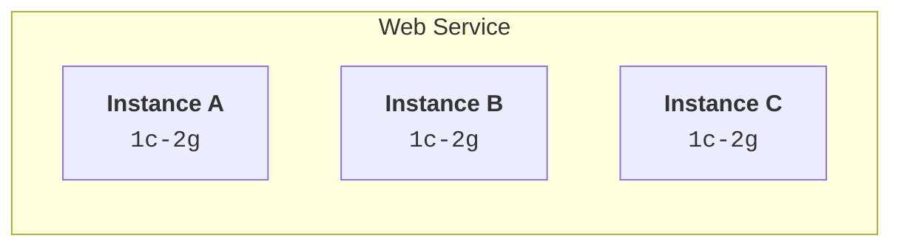

# Render Compute Plans — Specify your service's available CPU and RAM.


> *We've updated compute plan names and added new plans.*
>
> There are no pricing changes to existing plans. For other details, see [Updates to Render Compute Plans](compute-plans-update).

Your Render service's *compute plan* determines the CPU and RAM specs for its instances. For example, the *`1c-2g`* compute plan provides 1 CPU and 2 GB of RAM.

For most service types, you select a compute plan during [service creation](your-first-deploy) and can [change plans](#changing-a-services-compute-plan) later.

If you [scale](scaling) a service to run multiple instances, each instance uses the same compute plan and is billed accordingly:



Static sites do not have a compute plan at all, because they do not perform server-side processing.

## All plans

> *For pricing details on compute plans, see the [pricing page](/pricing#compute).*

Compute plans vary by service type:

**Tab: Web service**

#### Web service plans

| CPU | RAM | Plan ID | Legacy Plan Name |
| --- | --- | --- | --- |
| 0.1 CPU | 512 MB | [*`free`*](free) |  |
| 0.5 CPU | 512 MB | *`0.5c-512mb`* | *`starter`* |
| 1 CPU | 2 GB | *`1c-2g`* | *`standard`* |
| 2 CPU | 4 GB | *`2c-4g`* | *`pro`* |
| 2 CPU | 8 GB | *`2c-8g`* |  |
| 2 CPU | 16 GB | *`2c-16g`* |  |
| 4 CPU | 8 GB | *`4c-8g`* | *`pro_plus`* |
| 4 CPU | 16 GB | *`4c-16g`* | *`pro_max`* |
| 4 CPU | 32 GB | *`4c-32g`* |  |
| 8 CPU | 16 GB | *`8c-16g`* |  |
| 8 CPU | 32 GB | *`8c-32g`* | *`pro_ultra`* |
| 8 CPU | 64 GB | *`8c-64g`* |  |
| 12 CPU | 24 GB | *`12c-24g`* |  |
| 12 CPU | 48 GB | *`12c-48g`* |  |
| 12 CPU | 96 GB | *`12c-96g`* |  |

**Tab: Private service / Background worker**

#### Private service / Background worker plans

| CPU | RAM | Plan ID | Legacy Plan Name |
| --- | --- | --- | --- |
| 0.5 CPU | 512 MB | *`0.5c-512mb`* | *`starter`* |
| 1 CPU | 2 GB | *`1c-2g`* | *`standard`* |
| 2 CPU | 4 GB | *`2c-4g`* | *`pro`* |
| 2 CPU | 8 GB | *`2c-8g`* |  |
| 2 CPU | 16 GB | *`2c-16g`* |  |
| 4 CPU | 8 GB | *`4c-8g`* | *`pro_plus`* |
| 4 CPU | 16 GB | *`4c-16g`* | *`pro_max`* |
| 4 CPU | 32 GB | *`4c-32g`* |  |
| 8 CPU | 16 GB | *`8c-16g`* |  |
| 8 CPU | 32 GB | *`8c-32g`* | *`pro_ultra`* |
| 8 CPU | 64 GB | *`8c-64g`* |  |
| 12 CPU | 24 GB | *`12c-24g`* |  |
| 12 CPU | 48 GB | *`12c-48g`* |  |
| 12 CPU | 96 GB | *`12c-96g`* |  |

**Tab: Cron job**

#### Cron job plans

| CPU | RAM | Plan ID | Legacy Plan Name |
| --- | --- | --- | --- |
| 0.5 CPU | 512 MB | *`0.5c-512mb`* | *`starter`* |
| 1 CPU | 2 GB | *`1c-2g`* | *`standard`* |
| 2 CPU | 4 GB | *`2c-4g`* | *`pro`* |
| 2 CPU | 8 GB | *`2c-8g`* |  |
| 2 CPU | 16 GB | *`2c-16g`* |  |
| 4 CPU | 8 GB | *`4c-8g`* | *`pro_plus`* |
| 4 CPU | 16 GB | *`4c-16g`* |  |
| 4 CPU | 32 GB | *`4c-32g`* |  |
| 8 CPU | 16 GB | *`8c-16g`* |  |
| 8 CPU | 32 GB | *`8c-32g`* |  |
| 8 CPU | 64 GB | *`8c-64g`* |  |

**Tab: Workflow**

#### Workflow plans

Workflows define collections of runnable tasks. You specify which compute plan to use for _each task_ directly in your code. [Learn more.](/workflows-defining#compute-plan)

The `starter` and `standard` compute plans from the Render Workflows beta have been discontinued in favor of [`flex`](/workflows-limits#the-flex-compute-plan).

- The `flex` plan is now the default for any task that doesn't [specify a different plan](/workflows-defining#compute-plan).
- Any task that sets its plan to `starter` or `standard` now automatically uses `flex` instead.
- The `flex` plan is billed according to your task run's actual RAM and CPU usage. This results in lower costs for most tasks that previously used `starter` or `standard`.
- The `flex` plan provides up to the same CPU as `standard` and double the RAM.

| CPU | RAM | Plan ID | Legacy Plan Name |
| --- | --- | --- | --- |
| _Up to_ 1 CPU | _Up to_ 4 GB | [*`flex`*](/workflows-limits#the-flex-compute-plan) |  |
| 2 | 4 GB | *`2c-4g`* | *`pro`* |
| 2 | 8 GB | *`2c-8g`* |  |
| 4 | 8 GB | *`4c-8g`* | *`pro_plus`* |
| 4 | 16 GB | *`4c-16g`* | *`pro_max`* |
| 8 | 32 GB | *`8c-32g`* | *`pro_ultra`* |

**Tab: Postgres**

#### Render Postgres plans

> *Your Render Postgres compute plan does not affect storage capacity.*
>
> The compute plan only determines your database instance's RAM, CPU, and connection limit.
>
> Learn how to [add storage to your database](postgresql-creating-connecting#adding-storage).

------

###### *Max 100 connections:*

---

###### CPU

0.1 CPU

###### RAM

256 MB

###### Plan ID

[*`free`*](free)

###### Legacy Plan Name

---

###### CPU

0.1 CPU

###### RAM

256 MB

###### Plan ID

*`0.1c-256mb`*

###### Legacy Plan Name

*`basic-256mb`*

---

###### CPU

0.5 CPU

###### RAM

1 GB

###### Plan ID

*`0.5c-1g`*

###### Legacy Plan Name

*`basic-1gb`*

---

###### CPU

1 CPU

###### RAM

2 GB

###### Plan ID

*`1c-2g`*

###### Legacy Plan Name

---

###### CPU

1 CPU

###### RAM

4 GB

###### Plan ID

*`1c-4g`*

###### Legacy Plan Name

*`pro-4gb`*

---

###### *Max 200 connections:*

---

###### CPU

2 CPU

###### RAM

4 GB

###### Plan ID

*`2c-4g`*

###### Legacy Plan Name

*`basic-4gb`*

---

###### CPU

2 CPU

###### RAM

8 GB

###### Plan ID

*`2c-8g`*

###### Legacy Plan Name

*`pro-8gb`*

---

###### *Max 400 connections:*

---

###### CPU

2 CPU

###### RAM

16 GB

###### Plan ID

*`2c-16g`*

###### Legacy Plan Name

*`accelerated-16gb`*

---

###### CPU

4 CPU

###### RAM

16 GB

###### Plan ID

*`4c-16g`*

###### Legacy Plan Name

*`pro-16gb`*

---

###### CPU

4 CPU

###### RAM

32 GB

###### Plan ID

*`4c-32g`*

###### Legacy Plan Name

*`accelerated-32gb`*

---

###### *Max 500 connections:*

---

###### CPU

8 CPU

###### RAM

32 GB

###### Plan ID

*`8c-32g`*

###### Legacy Plan Name

*`pro-32gb`*

---

###### CPU

8 CPU

###### RAM

64 GB

###### Plan ID

*`8c-64g`*

###### Legacy Plan Name

*`accelerated-64gb`*

---

###### CPU

16 CPU

###### RAM

64 GB

###### Plan ID

*`16c-64g`*

###### Legacy Plan Name

*`pro-64gb`*

---

###### CPU

16 CPU

###### RAM

128 GB

###### Plan ID

*`16c-128g`*

###### Legacy Plan Name

*`accelerated-128gb`*

---

###### CPU

32 CPU

###### RAM

128 GB

###### Plan ID

*`32c-128g`*

###### Legacy Plan Name

*`pro-128gb`*

---

###### CPU

32 CPU

###### RAM

256 GB

###### Plan ID

*`32c-256g`*

###### Legacy Plan Name

*`accelerated-256gb`*

---

###### CPU

48 CPU

###### RAM

192 GB

###### Plan ID

*`48c-192g`*

###### Legacy Plan Name

*`pro-192gb`*

---

###### CPU

48 CPU

###### RAM

384 GB

###### Plan ID

*`48c-384g`*

###### Legacy Plan Name

*`accelerated-384gb`*

---

###### CPU

64 CPU

###### RAM

256 GB

###### Plan ID

*`64c-256g`*

###### Legacy Plan Name

*`pro-256gb`*

---

###### CPU

64 CPU

###### RAM

512 GB

###### Plan ID

*`64c-512g`*

###### Legacy Plan Name

*`accelerated-512gb`*

---

###### CPU

96 CPU

###### RAM

384 GB

###### Plan ID

*`96c-384g`*

###### Legacy Plan Name

*`pro-384gb`*

---

###### CPU

96 CPU

###### RAM

768 GB

###### Plan ID

*`96c-768g`*

###### Legacy Plan Name

*`accelerated-768gb`*

---

###### CPU

128 CPU

###### RAM

512 GB

###### Plan ID

*`128c-512g`*

###### Legacy Plan Name

*`pro-512gb`*

---

###### CPU

128 CPU

###### RAM

1024 GB

###### Plan ID

*`128c-1024g`*

###### Legacy Plan Name

*`accelerated-1024gb`*

------

**Tab: Key Value**

#### Render Key Value plans

Key Value plan IDs use a different naming format from other service types:

| RAM | Plan ID | Legacy Plan Name | Connection Limit |
| --- | --- | --- | --- |
| 25 MB | [*`free`*](free) |  | 50 connections |
| 256 MB | *`256mb`* | *`starter`* | 250 connections |
| 1 GB | *`1g`* | *`standard`* | 1,000 connections |
| 3 GB | *`3g`* |  | 3,000 connections |
| 5 GB | *`5g`* | *`pro`* | 5,000 connections |
| 10 GB | *`10g`* | *`pro_plus`* | 10,000 connections |
| 20 GB | *`20g`* | *`pro_max`* | 20,000 connections |
| 40 GB | *`40g`* | *`pro_ultra`* | 40,000 connections |
| 50 GB | *`50g`* |  | 50,000 connections |

> *Need larger compute plans?*
>
> Reach out with details about your use case:

## Changing a service's compute plan

> *The following services require brief downtime when changing their compute plan:*
>
> - [Render Postgres](postgresql-creating-connecting#changing-your-compute-plan)
> - [Render Key Value](key-value#changing-compute-plans)
> - Any service with an attached persistent disk
>
> Other services redeploy with [zero downtime](/deploys#zero-downtime-deploys).

Change your service's compute plan using any method listed below. Note that your service's compute plan does not change until the first successful deploy _after_ you update it.

**Tab: Dashboard**

1. Open your service's *Compute* page in the [Render Dashboard](https://dashboard.render.com).

2. Under *Compute*, click *Edit*:

    [image: Updating a service's compute plan in the Render Dashboard]

3. Select a new compute plan and click *Save*.

Render automatically triggers a deploy to apply the new compute plan.

**Tab: API**

> *Get started with the [Render API](api).*

1. Send a request to the Render API endpoint that corresponds to your service type:

    - [Update service](https://api-docs.render.com/reference/update-service) (all non-datastore services)
    - [Update Postgres instance](https://api-docs.render.com/reference/update-postgres)
    - [Update Key Value instance](https://api-docs.render.com/reference/update-key-value)

    In your request body, provide the new compute plan in the `plan` field. For [Update service](https://api-docs.render.com/reference/update-service), this field is nested under `serviceDetails`:

    ```json
    {
      "serviceDetails": {
        "plan": "1c-2g"
      }
    }
    ```

2. For [Update service](https://api-docs.render.com/reference/update-service), follow up with a request to the [Trigger deploy](https://api-docs.render.com/reference/create-deploy) endpoint to apply the new compute plan.
    - The Update service endpoint does _not_ trigger a new deploy.

**Tab: Blueprint (render.yaml)**

In your Blueprint file (usually `render.yaml`), set your service's `plan` field to a new compute plan:

```yaml
services:
  - type: web
    name: my-service
    runtime: node
    plan: 1c-2g
```

The next time you sync your Blueprint, Render triggers a deploy to apply the new compute plan.

## Plan ID format

Each compute plan has a corresponding plan ID. _Most_ plan IDs use the following format:

```
{CPU_COUNT}c-{RAM_GB}g
```

For example, the `1c-2g` plan provides 1 CPU and 2 GB of RAM.

*Exceptions include:*

- The [`free`](free) compute plan
- Paid compute plans with less than 1 GB of RAM
    - These end in `mb` instead of `g` (such as `0.5c-512mb`)
- Plan IDs for Render Key Value
    - These IDs only reflect memory (`256mb`, `1g`, and so on)
- [Legacy plan names](#legacy-plan-names)

### Legacy plan names

Render introduced new compute plan IDs in August 2026. Before this change, compute plans were called "instance types" and they used a different naming format (*Starter*, *Standard*, *Pro*, and so on).

- *Legacy plan names remain valid across all Render tooling.* This includes API requests and Blueprint files.

- *Each legacy plan name has a corresponding new plan ID.* In all cases, specs and pricing are identical:

| Legacy Plan Name | Plan ID | Key Value Plan ID |
| --- | --- | --- |
| *Starter* | *`0.5c-512mb`* | *`256mb`* |
| *Standard* | *`1c-2g`* | *`1g`* |
| *Pro* | *`2c-4g`* | *`5g`* |
| *Pro Plus* | *`4c-8g`* | *`10g`* |
| *Pro Max* | *`4c-16g`* | *`20g`* |
| *Pro Ultra* | *`8c-32g`* | *`40g`* |

  - For example, the *Standard* legacy plan name corresponds to the `1c-2g` plan ID (or the `1g` plan ID for Render Key Value).
  - You can update your configuration to use new plan IDs at any time.

Render Postgres has a separate set of legacy plan names (*Basic-1gb*, *Pro-4gb*, and so on). See the full mapping for Postgres under [All plans](compute-plans#all-plans).

---

##### Appendix: Glossary definitions

###### instance

A containerized environment that runs your service's code on Render.

You can select from a range of *compute plans* with different CPU and RAM specs.

###### static site

Deploy this *service type* to host a static website (HTML/CSS/JS) over a global CDN at a public URL.

Related article: https://render.com/docs/static-sites.md

###### service type

When you deploy code on Render, you select a *service type* based on the capabilities you need.

For example, you create a *web service* to host a dynamic web app at a public URL.

Related article: https://render.com/docs/service-types.md

###### web service

Deploy this *service type* to host a dynamic application at a public URL.

Ideal for full-stack web apps and API servers.

Related article: https://render.com/docs/web-services.md

###### private service

Deploy this *service type* to host a dynamic application that is not internet-reachable.

Ideal for internal apps that only your other Render services can access.

Related article: https://render.com/docs/private-services.md

###### background worker

Deploy this *service type* to continuously run code that does not receive incoming requests.

Ideal for processing jobs from a queue.

Related article: https://render.com/docs/background-workers.md

###### cron job

Deploy this *service type* to execute a command or script on a predefined schedule.

Ideal for intermittent tasks like sending email digests or generating reports.

Related article: https://render.com/docs/cronjobs.md

###### Render Workflows

Define collections of long-running *tasks* that execute across distributed compute.

Ideal for agents, ETL pipelines, and background jobs.

Related article: https://render.com/docs/workflows.md

###### Render Postgres

Fully managed PostgreSQL databases that support point-in-time recovery, read replicas, high availability, and more.

Related article: https://render.com/docs/postgresql.md

###### Render Key Value

Fully managed, Redis®-compatible storage ideal for use as a job queue or shared cache.

Related article: https://render.com/docs/key-value.md

###### persistent disk

A high-performance SSD that you can attach to a service to preserve filesystem changes across deploys and restarts.

Disables [zero-downtime deploys](/deploys#zero-downtime-deploys) for the service.

Related article: https://render.com/docs/disks.md